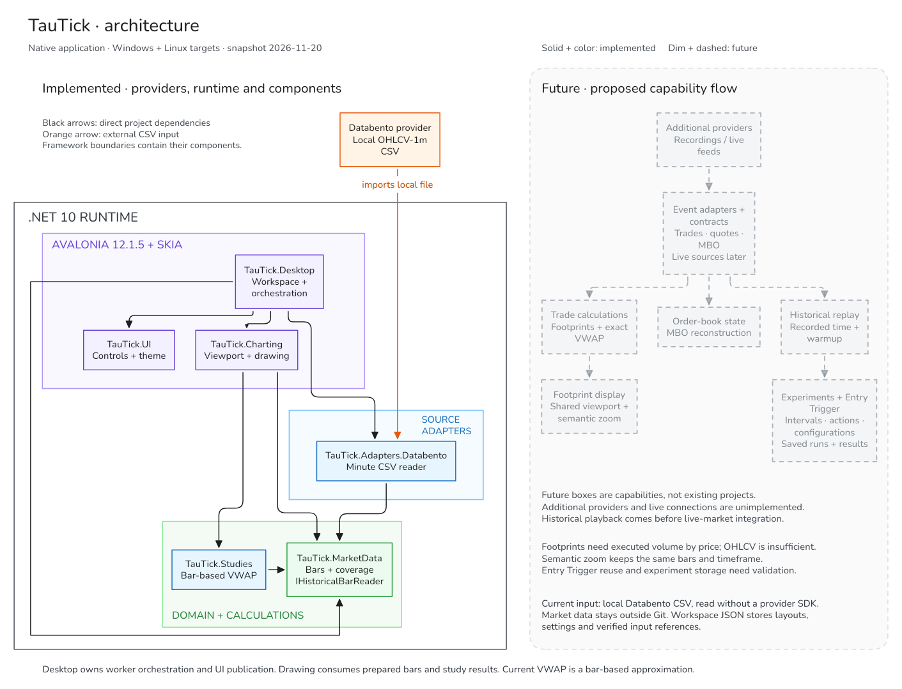

# Architecture reference

This is a living map of the implementation, checked against the production source
and project references on **2026-11-20**. Update it alongside changes to component
ownership, dependencies or delivered capabilities. The earlier
[chart viewer plan](charting-mvp.md) records milestone proposals; it is not a current
feature inventory.

The repository's [Excalidraw file](assets/architecture.excalidraw) is the editable
source; the [PNG](assets/architecture.png) is its rendered companion, embedded here
and in the [README](../README.md#architecture). The
[Excalidraw working copy](https://app.excalidraw.com/s/UnTIZtN2ge/aOZqqdjwmI)
can also be used for editing. Keep repository copies current when editing online.

## Reading the diagram

The left panel shows the **.NET 10 runtime** enclosing all six production projects.
The nested **Avalonia 12.1.5 / Skia** boundary contains Desktop, UI and Charting;
Windows and Linux are the native platform targets. The separate **source-adapter**
and **domain/calculation** boundaries contain plain .NET code without Avalonia.
These versions come from [Directory.Build.props](../Directory.Build.props) and
[Directory.Packages.props](../Directory.Packages.props).

**Databento is an external provider**, shown outside the application. Its orange
arrow represents a local OHLCV-1m CSV entering the implemented Databento adapter.
The application currently reads that file without a provider SDK, credentials or
network connection. Other providers and live feeds remain dimmed future work.

Black arrows point from a consumer to a **direct `ProjectReference` dependency**,
not in the direction of runtime data flow. Purple components use Avalonia; blue and
green components build without it. These are code boundaries in one native
application, not deployed services. Chart presentation and drawing currently share
the Charting project.

The right panel is dimmed with dashed outlines and arrows. It shows **unimplemented
capabilities and proposed data flow**, not existing projects or agreed interfaces.
It is not a delivery sequence. Footprints can use trades without MBO reconstruction;
OHLCV bars cannot supply executed volume by price. Semantic zoom must retain the
same bar boundaries and timeframe.

## Current ownership

| Project | Responsibility |
| --- | --- |
| [TauTick.Desktop](../src/TauTick.Desktop) | Composes the application; owns workspace windows, content tabs, chart documents, CSV loading, study lifecycle, cancellation, UI publication and local layout persistence. |
| [TauTick.UI](../src/TauTick.UI/README.md) | Shared native controls and theme. The separate [gallery](../samples/TauTick.UI.Gallery/README.md) exercises them during development. |
| [TauTick.Charting](../src/TauTick.Charting) | Custom Avalonia chart, viewport, pan/zoom, axes, crosshair inspection and rendering of prepared candles and study results. |
| [TauTick.Adapters.Databento](../src/TauTick.Adapters.Databento/README.md) | Validates and imports local Databento minute CSVs through `IHistoricalBarReader`. |
| [TauTick.Studies](../src/TauTick.Studies) | UI-independent calculation definitions and immutable results. The production catalog currently contains bar-based VWAP. |
| [TauTick.MarketData](../src/TauTick.MarketData) | Immutable bars and datasets, instrument/source identity, timestamps, coverage, reader results and import errors. |

At runtime, Desktop opens a local CSV and runs snapshot verification and parsing on
a worker. The adapter returns an accepted immutable `BarDataset`; Desktop publishes
it on the UI thread. Charting consumes those bars, while Desktop's `ChartStudies`
runs study calculations on workers and publishes prepared results for rendering.
Failed replacement keeps the accepted chart; closed or superseded work cannot
publish into the current document. Drawing does no provider I/O or market-state
reconstruction. See the [workspace](workspace.md), [chart](chart-control.md) and
[indicator](indicators.md) guides for the detailed contracts.

Current VWAP is an explicitly anchored **bar-based approximation**, not exact trade
or session VWAP. Exact calculations need suitable trade data and verified coverage.
Workspace JSON stores layouts, settings and verified CSV references, not market
data or experiments. Downloaded inputs remain outside Git, following the
[sample-data guide](sample-data/README.md).

Event ingestion, footprint calculations/rendering, order-book reconstruction,
historical replay, warmup and saved experiments remain future work. Entry Trigger
reuse from TradingLab is a proposed integration whose mechanism needs validation;
see the [recorded-session brief](recorded-session-research.md). Live connections
come after the historical workflow. The diagram does not claim performance or
complete Windows/Linux acceptance; existing validation reports retain that evidence.

## Updating the reference

1. Inspect the affected source, `src/*/*.csproj` references and central framework
   versions. Keep black arrows aligned with direct references, including direct
   references also reachable transitively. Keep providers outside the runtime
   boundary and their adapters inside it; orange arrows describe supported input.
   Move a future capability into the implemented view only when supported by code;
   choose its real owner rather than inventing a project.
2. Open [architecture.excalidraw](assets/architecture.excalidraw) in Excalidraw and
   edit the native shapes and bound arrows. If using the online working copy,
   start from the repository version when it is newer. Update the snapshot date
   and this document's ownership notes when the architecture changes.
3. Save the editable file back to `docs/assets/architecture.excalidraw`. Export the
   full canvas as `docs/assets/architecture.png` with a light, opaque background
   and enough resolution to read labels at full size. Export both after the same
   edit; the PNG is not an independently maintained drawing.
4. Inspect the exported image for clipped text, overlapping connectors and legible
   dimmed components. Check the image and source links here and in the README.
   Commit the source, image and relevant documentation together. Documentation-only
   changes need these checks, not a native application build or UI test pass.
